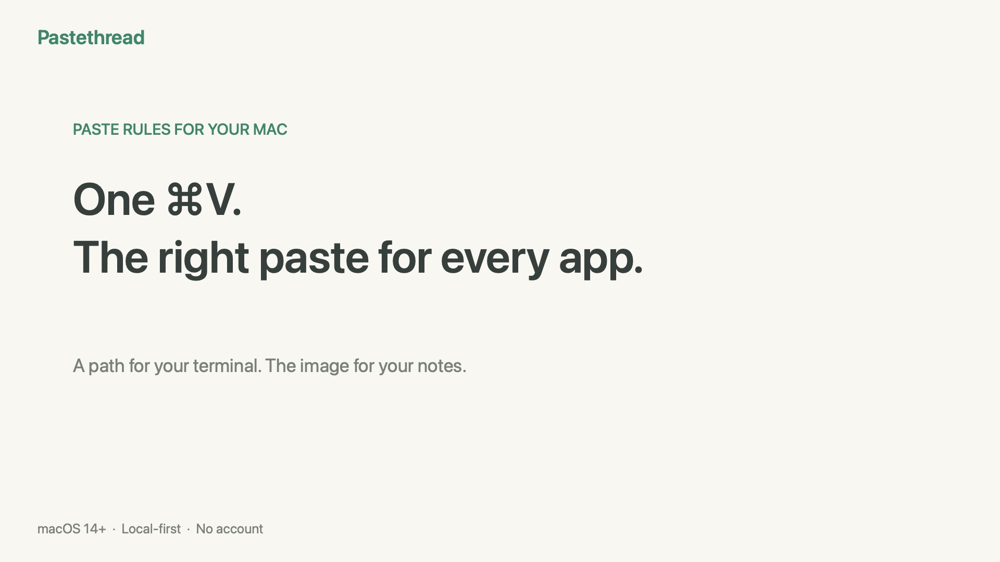
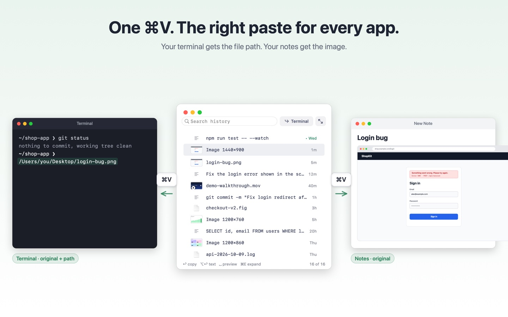
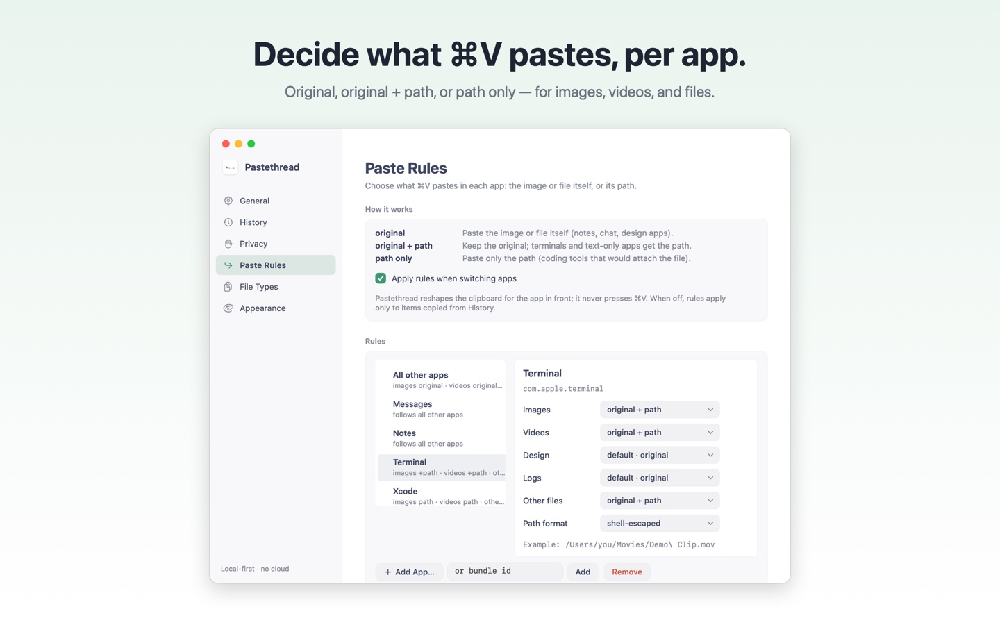
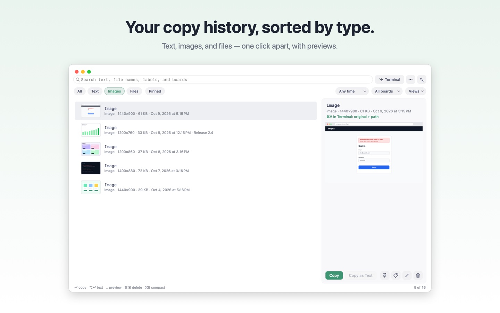
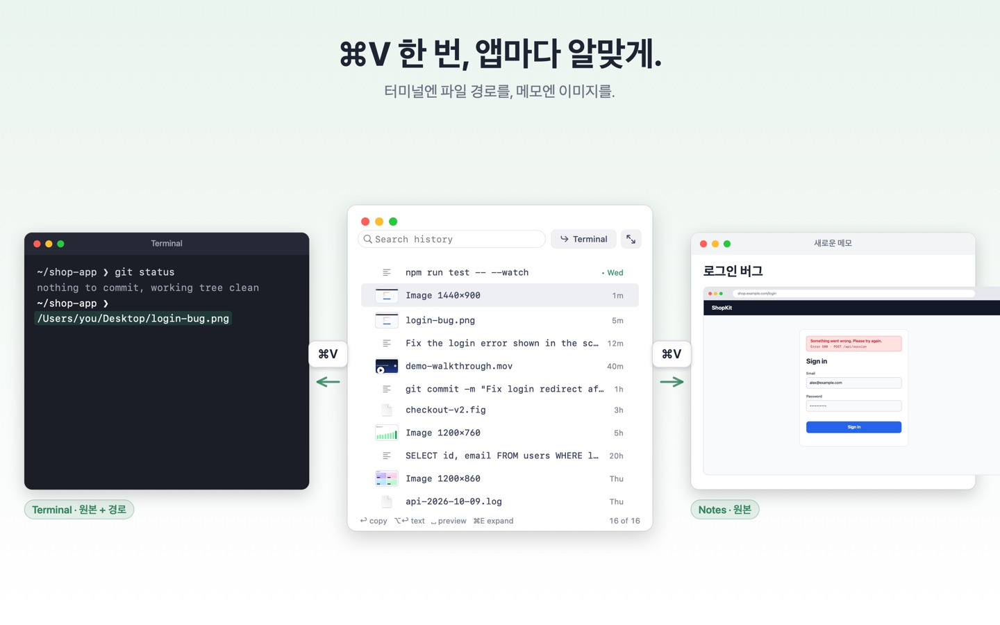

<h1 align="center">Pastethread</h1>

<strong>One ⌘V. The right paste for every app.</strong> 
A menu bar clipboard manager for Mac developers who work with AI coding agents and terminals.

<a href="https://apps.apple.com/app/id6820030486">Mac App Store</a> ·
<a href="https://luke-cha.github.io/pastethread/">Website</a> ·
<a href="https://luke-cha.github.io/pastethread/support.html">Support</a> ·
<a href="https://luke-cha.github.io/pastethread/privacy.html">Privacy Policy</a> ·
<a href="#한국어">한국어</a>

▶ **[Watch the 36-second introduction](https://luke-cha.github.io/pastethread/#demo)**: a path in Terminal, the image in Notes, and searchable copy history. With English or Korean AI narration and on-screen explanations, edited from a real Mac recording.

**[Get Pastethread on the Mac App Store](https://apps.apple.com/app/id6820030486)** · Paid app; see the store for your local price.

## What it does

Copy a screenshot once. When you press ⌘V in your terminal, it pastes the file path. Press ⌘V in Notes and you get the image.

Some terminals can't paste an image at all, and an AI agent running in one needs the image's path. Coding tools often attach the image when all you wanted was the path. Notes, chat, and design apps should get the real thing. Pastethread gives each app the right one, and you keep using ⌘V the way you always do.

### Paste Rules

Choose what ⌘V pastes in each app, separately for images, videos, other files, and file types you define:

| Mode | What the app gets | Typical apps |
|---|---|---|
| **original** | the image or file itself | notes, chat, design apps |
| **original + path** | the original, plus the file path as text | terminals |
| **path only** | just the path | coding tools that would attach the file |

Paths can be plain, shell-escaped, or quoted. Set a rule from the menu bar ("Paste Rules for <app>"), from the History window, or in Settings. Terminals start with a ready-made preset.

### Copy history, sorted by type

- Text, rich text, images, and files, one click apart: All · Text · Images · Files.
- ⌥⌘F opens the history from anywhere. Type, pick, press Return, and the paste rule for the app you came from is applied.
- Image files are previewed, and so is a video's first frame. Optional on-device text recognition makes text inside screenshots searchable (off by default).
- Pins, boards, saved views, and an expanded view with a large preview.
- Up to 10,000 items or 1 GB of history, with an adjustable retention period.

### Private by design

- Everything stays on your Mac: no account, no cloud, no analytics, no tracking.
- Pastethread never presses ⌘V for you and needs no Accessibility permission. It reshapes the clipboard when you switch apps.
- Skips content that apps mark as concealed (for example, from password managers). You can exclude any app.
- History is stored unencrypted in the app's sandbox container, readable only by your user account. Export and import are available.

## Requirements

- macOS 14 Sonoma or later
- [Available on the Mac App Store](https://apps.apple.com/app/id6820030486)

## Support

Report problems or ask for features in [Issues](https://github.com/luke-cha/pastethread/issues), or see the [Support page](https://luke-cha.github.io/pastethread/support.html).

---

## 한국어

**⌘V 한 번, 앱마다 알맞게.** AI 코딩 에이전트와 터미널로 일하는 Mac 개발자를 위한 메뉴 막대 클립보드 관리자입니다.

스크린샷을 한 번 복사하면, 터미널에서 ⌘V하면 파일 경로가, 메모에서 ⌘V하면 이미지가 들어갑니다. 이미지를 붙여넣지 못하는 터미널이나 그 안의 AI 에이전트에게는 경로가 필요하고, 코딩 도구는 경로만 원할 때도 이미지를 첨부해 버리곤 합니다. 메모·채팅·디자인 앱에는 원본이 맞습니다. Pastethread는 평소처럼 ⌘V만 눌러도 앱마다 알맞은 것을 넣어 줍니다.

- **Paste Rules**: 앱별, 그리고 이미지·영상·기타 파일·직접 만든 파일 종류별로 `원본` · `원본 + 경로` · `경로만`을 고릅니다. 메뉴 막대, History 창, Settings에서 설정하며 터미널에는 기본 설정이 자동으로 적용됩니다.
- **종류별 복사 기록**: 텍스트·이미지·파일로 나눠 보고, ⌥⌘F로 어디서든 열어 검색한 뒤 엔터로 복사합니다. 이미지와 영상 첫 장면을 미리 봅니다. 선택 기능인 기기 내 텍스트 인식을 켜면 스크린샷 속 글자도 검색할 수 있습니다(기본 꺼짐).
- **내 Mac 안에서만**: 계정·클라우드·분석·추적이 없습니다. ⌘V를 대신 누르지 않으며 접근성 권한도 필요 없습니다. 기록은 앱 샌드박스 안에 암호화 없이, 사용자 계정만 읽을 수 있게 저장됩니다.

**[Mac App Store에서 보기](https://apps.apple.com/kr/app/id6820030486)** · 유료 앱, 지역별 가격은 스토어에서 확인하세요.

▶ [36초 한국어 소개 영상](https://luke-cha.github.io/pastethread/ko/#demo) · [웹사이트](https://luke-cha.github.io/pastethread/ko/) · [지원](https://luke-cha.github.io/pastethread/ko/support.html) · [개인정보 처리방침](https://luke-cha.github.io/pastethread/ko/privacy.html)

---

© 2026 Pastethread. The app is distributed through the Mac App Store; this repository hosts its website, support, and privacy pages.
